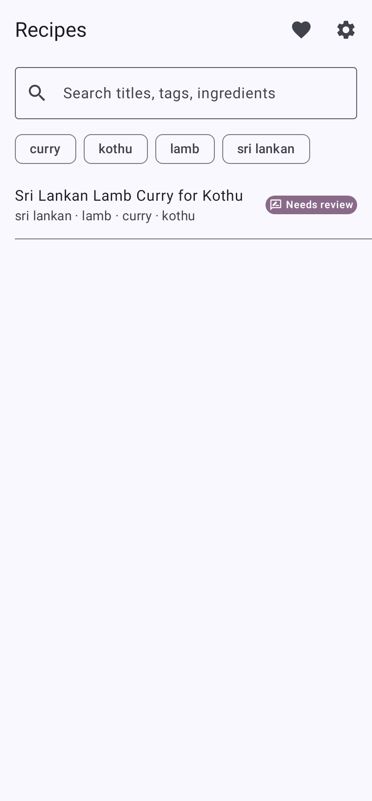
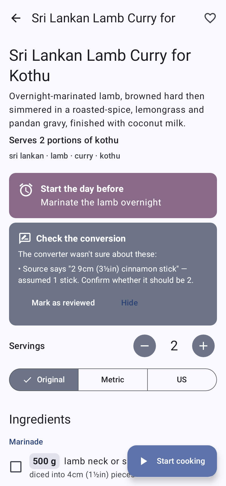
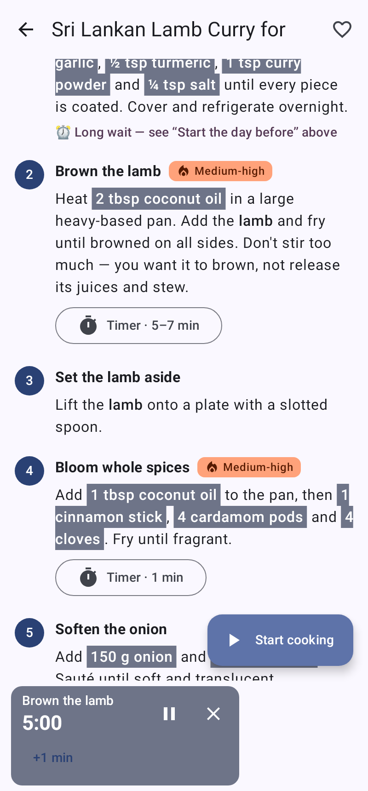
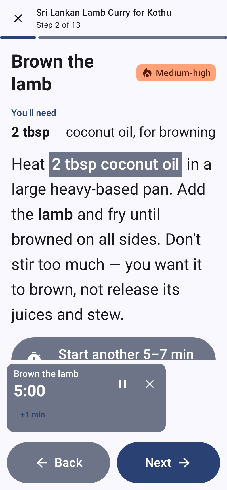
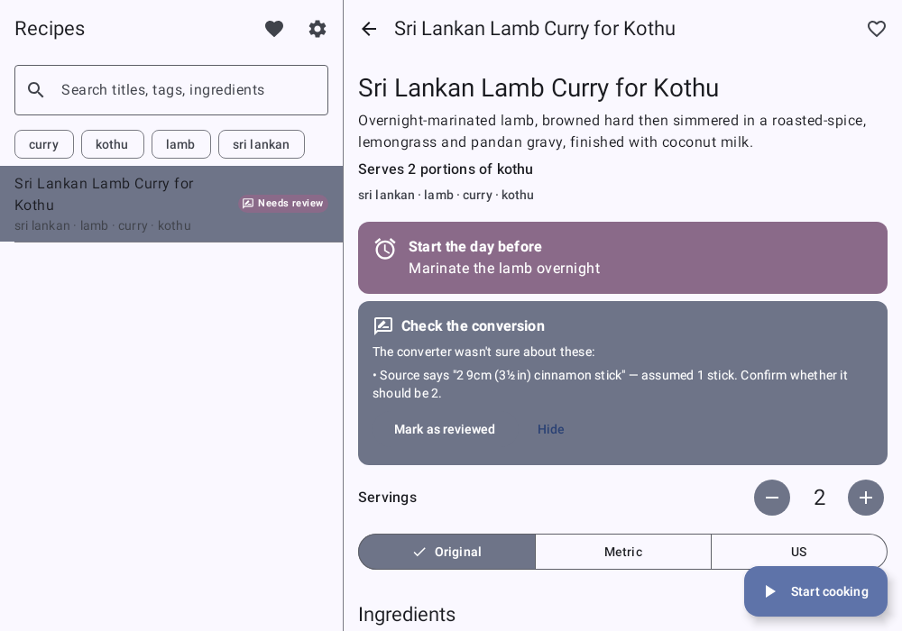
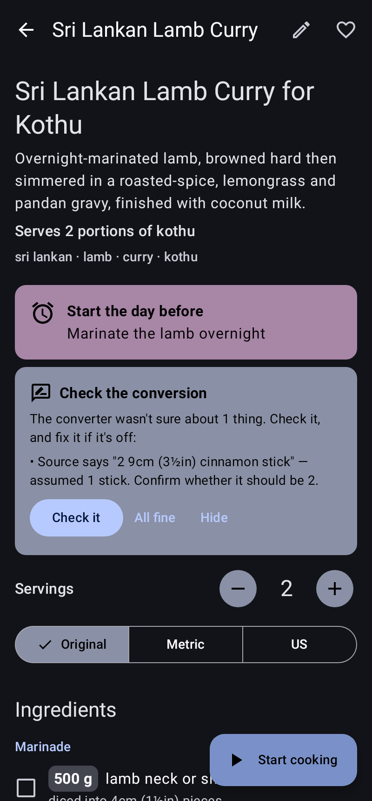

# Mise

A personal recipe app for Android, with two small companion tools for your PC:

* **The app** shows recipes in a cook-friendly way: scale servings (or scale to "I've only got
  400 g lamb"), switch between original / metric / US units, amounts written right into the steps,
  step timers that keep ringing with the screen locked, and a big-text cooking mode for messy hands.
* **The server** (`mise-server`) shares the recipes folder on your PC with the phone over your home
  Wi-Fi. The phone keeps a copy of everything, so the kitchen works with the PC switched off.
* **The converter** (`convert`) turns messy pasted recipe text into the app's structured format, once
  per recipe, using the Claude API. It runs on your PC only — the phone never holds an AI key.

<p align="center">
  
  
  
  
</p>

---

## 5-minute setup

You need: a PC (Windows, macOS or Linux) and an Android phone (Android 8 or newer) on the same Wi-Fi.

### On the PC

1. **Install Python 3.10 or newer** from <https://www.python.org/downloads/>.
   On Windows, tick **"Add python.exe to PATH"** in the installer.
2. **Get this project** onto the PC — on GitHub, **Code → Download ZIP**, and unzip it somewhere
   permanent (e.g. `Documents\mise-app`). Or `git clone` it.
3. **Run the setup script once.** Open a terminal *in the project folder*:
   * **Windows:** right-click the folder → *Open in Terminal*, then
     ```powershell
     powershell -ExecutionPolicy Bypass -File scripts\setup.ps1
     ```
   * **macOS / Linux:**
     ```bash
     scripts/setup.sh
     ```
   This creates a private Python environment in `.venv`, the `recipes/` and `inbox/` folders, and a
   `config.toml` with a fresh random access token.
4. **Start the server:**
   * Windows: `powershell -ExecutionPolicy Bypass -File scripts\server.ps1`
   * macOS / Linux: `scripts/server.sh`

   It prints the address your phone should use, the access token and a **QR code**. Leave the window
   open while you want the phone to sync. (Can't scan the terminal QR? Open
   <http://localhost:8765/> in a browser **on the PC** for a bigger one.)
5. **Allow it through the firewall** the first time:
   * **Windows** shows a *Windows Defender Firewall* prompt — tick **Private networks** and click
     *Allow access*. No prompt? See [Firewall](#firewall).
   * **macOS** may ask "Do you want the application *python* to accept incoming connections?" — click
     *Allow*.

### On the phone

1. **Get the app (APK file).** Two options:
   * **Easiest:** on GitHub open **Actions → CI → the latest green run → Artifacts →
     `mise-debug-apk`**, download and unzip it on the phone (or copy `app-debug.apk` to it).
   * **Build it yourself:** see [Building the app](#building-the-app).
2. **Install it.** Tap `app-debug.apk`. Android will ask to allow installs from your browser / Files
   app ("Install unknown apps") — allow it for that app, then tap *Install*.
   (Play Protect may warn about an unknown developer: tap *More details → Install anyway*. It's your
   own build.)
3. **Pair with the PC.** Open Mise → ⚙ **Settings → Pair with PC** and scan the QR code from step 4.
   You can also just point the normal camera app at the QR code — it opens Mise and asks to pair.
   No camera handy? Tap *Enter manually* and type the address and token the server printed.
4. Pull down on the recipe list to sync. Done.

Until you pair, the app shows a built-in demo recipe (the Sri Lankan lamb curry), so you can try
everything straight away.

---

## Converting your recipes

Short version (details in **[docs/converting.md](docs/converting.md)**):

1. Get an API key at <https://platform.claude.com/> and set it **in the terminal you'll use**:
   * Windows: `$env:ANTHROPIC_API_KEY = "sk-ant-..."`
   * macOS / Linux: `export ANTHROPIC_API_KEY=sk-ant-...`
2. Paste each recipe into its own `.txt` (or `.md`) file in the `inbox/` folder. Messy is fine.
3. Run `powershell -ExecutionPolicy Bypass -File scripts\convert.ps1 run` (Windows) or
   `scripts/convert.sh run` (macOS/Linux). It shows how
   many recipes it will convert and a rough cost, and asks before sending anything.
4. Converted recipes appear in `recipes/`, and the running server picks them up immediately.
   Anything the converter wasn't sure about gets a **Needs review** badge in the app — open the recipe,
   read the *Check the conversion* card, compare with "View original text" if in doubt, and tap **Mark as reviewed**.

Running `convert run` again only converts new or changed files.

---

## Using the app

* **Servings:** − / + (half steps for small amounts). Tap any **amount in the ingredient list** to
  scale the whole recipe to what you have ("I've only got 400 g lamb").
* **Units:** *Original* (as written), *Metric* or *US*. Weights and liquids convert; teaspoons,
  tablespoons, pinches and "4 cardamom pods" stay as they are. Both settings are remembered per recipe.
* **Steps:** amounts appear inline, highlighted. Tap one to find that ingredient in the list.
* **Timers:** tap a step's timer. For ranges like 5–7 min it rings "check now" at 5, then offers
  **+1 min** or **To max**. Several timers can run at once; they keep going (and ring) with the app
  in the background or the screen locked. On first use Android asks to allow notifications — allow
  it, or timers can only beep while the app is running.
* **Cooking mode** (▶ Start cooking): one step per screen, huge text, swipe or big Back/Next
  buttons, the step's ingredients on top, screen stays on.
* **My notes:** your own notes per recipe, kept separate from the author's. They sync back to the PC
  (in `recipes/<id>.user.json`), as do favourites, "Mark as reviewed" and **I made this** (which feeds
  *Recently cooked*).
* **Tablets / foldables:** the list and the recipe show side by side.
* **Settings:** default units, theme, text size (on top of Android's own font size), timer sound,
  keep-screen-on, background sync.

### Without the PC: folder mode

Settings → *Recipes come from* → **Folder on this phone**, then **Choose folder** (e.g. a Syncthing or
Google Drive folder that mirrors the PC's `recipes/` folder) or **Import files** for individual
`.json` files. Notes you make in folder mode stay on the phone.

---

## Your recipe library (and backups)

The **`recipes/` folder is the source of truth**: plain JSON files you can read, edit, diff and copy.

| File | What it is |
|---|---|
| `<id>.json` | the recipe (written by the converter; the app never changes it) |
| `<id>.source.txt` | the original text, for "View original text" |
| `<id>.user.json` | your notes, favourite, reviewed flag and cook log (written via the app) |
| `<id>.jpg` / `.png` / `.webp` | optional photo — just drop one in with the same name |
| `.mise/` | the converter's bookkeeping (manifest, failed outputs) |

**Back it up** like any important folder: put it inside a synced folder (OneDrive, iCloud Drive,
Dropbox, Syncthing…) by setting `recipes_dir` in `config.toml`, or copy it somewhere now and then.
The phone's copy is a cache — if you lose the phone, nothing is lost.

You can hand-edit a recipe JSON: the server checks every file against the schema and **skips (and
logs) invalid files** instead of crashing, and shows changes without a restart. Field reference:
[schema/README.md](schema/README.md).

---

## Running the server automatically

* **Windows** — Task Scheduler → *Create Basic Task* → trigger *When I log on* → action *Start a
  program*: Program `powershell.exe`, Arguments
  `-ExecutionPolicy Bypass -WindowStyle Minimized -File "C:\path\to\mise-app\scripts\server.ps1"`.
* **macOS** — save as `~/Library/LaunchAgents/app.mise.server.plist` (fix the path), then
  `launchctl load ~/Library/LaunchAgents/app.mise.server.plist`:
  ```xml
  <?xml version="1.0" encoding="UTF-8"?>
  <!DOCTYPE plist PUBLIC "-//Apple//DTD PLIST 1.0//EN" "http://www.apple.com/DTDs/PropertyList-1.0.dtd">
  <plist version="1.0"><dict>
    <key>Label</key><string>app.mise.server</string>
    <key>ProgramArguments</key><array>
      <string>/Users/YOU/mise-app/scripts/server.sh</string><string>--no-qr</string>
    </array>
    <key>RunAtLoad</key><true/>
    <key>KeepAlive</key><true/>
  </dict></plist>
  ```
* **Linux** (systemd user service) — `~/.config/systemd/user/mise.service`:
  ```ini
  [Service]
  ExecStart=%h/mise-app/scripts/server.sh --no-qr
  Restart=on-failure
  [Install]
  WantedBy=default.target
  ```
  then `systemctl --user enable --now mise`.

### Firewall

The server listens on TCP port **8765** (change `port` in `config.toml`).

* **Windows** (PowerShell *as administrator*, Private networks only):
  ```powershell
  New-NetFirewallRule -DisplayName "Mise server" -Direction Inbound -Protocol TCP -LocalPort 8765 -Action Allow -Profile Private
  ```
  Make sure your home Wi-Fi is set to **Private** (Settings → Network → your network → *Private network*).
* **macOS** — System Settings → Network → Firewall → Options → allow incoming connections for
  `python3` (the one inside the project's `.venv`).
* **Linux** — e.g. `sudo ufw allow from 192.168.0.0/16 to any port 8765 proto tcp`.

---

## Security notes

* The server only runs on your home network and **every request except a health check needs the
  access token**. Treat the token (and the pairing QR code) like a Wi-Fi password. To change it,
  delete the `token` line in `config.toml` and restart the server; then pair the phone again.
* The connection is **plain HTTP**, not HTTPS. Android blocks plain HTTP by default and can't make an
  exception for "addresses on my home network" (only for named domains), so the app allows it
  everywhere. In practice the app only talks to the address you paired with. Someone on your Wi-Fi
  could in principle read recipe traffic (and the token); on a home network that's an acceptable
  trade-off for a recipe app. *(TODO in the code: optional HTTPS with a self-signed certificate.)*
* The Claude API key is only read from the `ANTHROPIC_API_KEY` environment variable on the PC. It is
  never written to disk, logged, or sent to the phone.

---

## Troubleshooting

| Problem | Try |
|---|---|
| "Can't reach your PC — showing cached recipes" | Is the server window open? Phone on the same Wi-Fi (not mobile data / guest network)? Firewall allowed? Open `http://<PC address>:8765/api/v1/health` in the phone's browser — it should say `"status":"ok"`. |
| "The PC rejected the access token" | The token changed. Pair again (Settings → Pair with PC). |
| The address printed by the server doesn't work | PCs with several network adapters (VPN, Docker…) may print the wrong one; the server lists alternatives ("also maybe"). On Windows, `ipconfig` shows your Wi-Fi adapter's IPv4 address. |
| A recipe doesn't appear | The server log says `Skipping <file>: …` with the reason (invalid JSON or schema error). |
| Timers don't ring with the screen off | Allow notifications for Mise; on some phones also set Mise's battery usage to *Unrestricted*. |
| QR scanner unavailable | It needs Google Play services. Use the phone's camera app instead, or *Enter manually*. |

---

## For developers

```
schema/        recipe.schema.json — the contract (+ README)
fixtures/      raw recipe text + expected structured JSON (used by every test suite and as the app's demo recipe)
shared/        Python: Pydantic models, schema + semantic validation, config
converter/     Python: `convert` CLI and the versioned prompt (converter/prompts/convert_recipe.md)
server/        Python: `mise-server` (FastAPI)
android/       Gradle project: :core (pure Kotlin: scaling, units, formatting, placeholders, timers) and :app (Compose)
scripts/       setup / run scripts for PowerShell and bash
docs/          converting guide, screenshots
PLAN.md        architecture, decisions and progress log
```

### Tests

```bash
.venv/bin/pytest                          # Python: contract, converter (API mocked), server
.venv/bin/pytest -m live                  # + one real conversion of the fixture (needs ANTHROPIC_API_KEY)
cd android && ./gradlew assembleDebug test lintDebug
```

The Android tests include Room migration tests, the sync layer, the HTTP client (mocked), and UI
tests that render the real screens under Robolectric. `-Pmise.screenshots=true` refreshes
`docs/screenshots/`. To check the app's HTTP client against a running server:
`./gradlew :app:testDebugUnitTest --tests '*LiveServerE2ETest' -Pmise.e2eUrl=http://127.0.0.1:8765 -Pmise.e2eToken=<token>`.

### Building the app

Install [Android Studio](https://developer.android.com/studio), open the `android/` folder, wait for
the sync to finish, plug in the phone with USB debugging on, and press ▶ Run. Or from a terminal with
JDK 17+ and the Android SDK: `cd android && ./gradlew assembleDebug` → `app/build/outputs/apk/debug/app-debug.apk`.

<p align="center">
  
  
</p>
